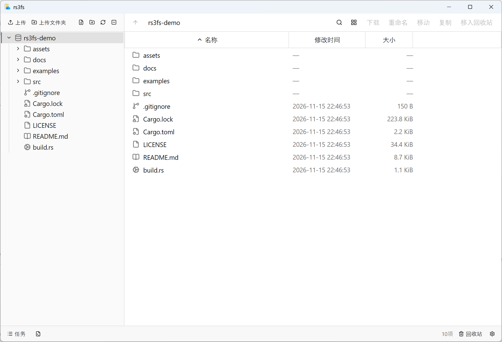
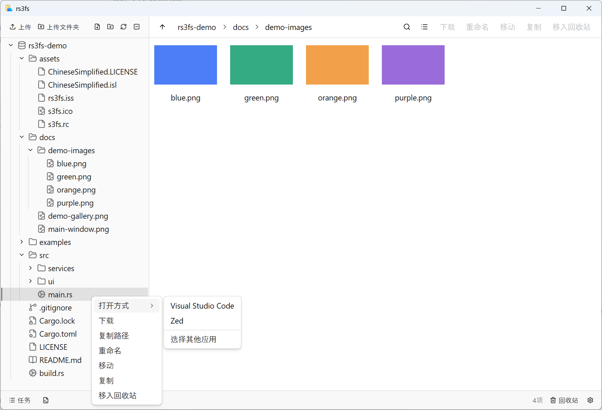

本项目由 OpenAI GPT-6.1 Sol（Codex）参与开发。

# rs3fs

A Windows file manager for S3-compatible object storage.

rs3fs 使用 Rust、GPUI Kit 和 AWS SDK for Rust 构建，支持 AWS S3 及兼容的 S3 API。

## Windows 安装与便携版

- **安装版**运行 `rs3fs-<版本>-windows-x64-setup.exe`。首次安装默认使用简体中文，也可选择英文。默认安装到当前用户的 `%LOCALAPPDATA%\Programs\rs3fs`，无需管理员权限。安装器创建开始菜单快捷方式，可选桌面图标。可通过 Windows 的「已安装的应用」卸载，连接、同步和传输记录会保留。
- **便携版**直接运行 `rs3fs.exe`。两种版本共用当前用户的配置。升级或卸载前，可在通知区域选择「退出（停止同步）」。

两个产物均未签名。便携版需要系统已安装 [Microsoft Visual C++ x64 运行库](https://learn.microsoft.com/cpp/windows/latest-supported-vc-redist)。安装版已包含程序所需的 Visual C++ 运行库 DLL。

## 界面

主界面显示示例桶 `rs3fs-demo` 的目录树和文件列表。



图片目录切换到网格视图后会加载缩略图。截图来自本机运行的 RustFS 服务，示例桶中的四张纯色 PNG 可在 [docs/demo-images](docs/demo-images) 找到。



### 一键运行示例

在 Windows x64 的 Git 源码目录中运行。首次运行需要访问 GitHub Releases，并使用 Windows 自带的 `curl.exe`、Windows PowerShell 和 `tar.exe`。终端会显示下载进度；下载优先使用 `HTTPS_PROXY` 或 `ALL_PROXY`，否则读取当前用户的 Windows 系统代理设置，并尊重 `NO_PROXY`。

```powershell
cargo run --locked --example rs3fs-demo
```

Cargo 示例首次运行会下载 [RustFS 1.0.5](https://github.com/rustfs/rustfs/releases/tag/1.0.5) Windows 发行包，校验 SHA-256 后缓存到 `target/rs3fs-demo`。它在 `127.0.0.1` 的临时端口启动 RustFS，将 Git 已跟踪文件的当前工作副本及示例图片上传到 `rs3fs-demo` 桶，然后打开 rs3fs 并自动连接。

示例工作目录是 `target/rs3fs-demo/work`。下载对话框默认打开其中的 `downloads`，预览缓存保存在 `preview-cache`。这两个目录在退出后保留，示例桶和连接配置则随会话清理。

要结束示例，在通知区域右键选择「退出（停止同步）」，或在运行示例的终端按 Ctrl+C。再次启动时会重新导入源码。

## 功能

- **从任务记录继续中断的传输。** 支持后台上传、下载和取消，任务面板显示进度、速率和错误，输出面板记录操作详情。上传、下载、预览和同步共享同一个可调并发上限。
- **预览和直接编辑远端对象。** 内置图片、PDF 和带语法高亮的文本预览，可清理预览缓存。编辑文本后，通过 ETag 条件写入保存，避免覆盖他人已经改动的对象。也可将本地文件与远端对象的 ETag 比对。
- **按文件夹后台同步。** 支持仅上传、仅下载和双向同步。可查看每个任务的上次执行结果，处理冲突，并按需开启删除同步。自动任务在上次运行结束约五分钟后再次执行，支持 Windows 登录启动和在通知区域后台运行。
- **批量管理远端对象。** 支持新建、复制、移动、重命名和移入桶内回收站，并提供还原、永久删除和有时效的下载链接。
- **像操作本地文件一样浏览。** 支持列表排序、调整列宽、缩略图网格和 Windows 触摸操作。可从资源管理器拖入或粘贴文件和目录上传，也可将远端对象下载到本地后复制到 Windows 文件剪贴板。
- **管理多套连接凭证。** 支持为不同端点保存配置、切换连接及隐藏暂时不用的桶。Ctrl+F 搜索文件，Ctrl+Shift+P 搜索设置，F2 重命名，F5 刷新。

## 从源码运行

准备 Windows x64、Rust MSVC 工具链及 Visual Studio Build Tools 的 C++ 桌面开发组件。锁定的依赖声明需要至少 Rust 1.94.1，本项目已在 Rust 1.99.1 上验证构建。

```powershell
cargo run --locked
# 构建发布版，产物位于 target/release/rs3fs.exe
cargo build --release --locked
```

### 构建安装器

在 Windows x64 上准备上面列出的构建工具及 [Inno Setup 7（推荐 x64 版）](https://jrsoftware.org/inno-setup/downloads)，然后运行 Cargo 打包命令。脚本也支持 Inno Setup 6.5 及以上的 6.x 版本，会从 PATH 和常见安装目录查找 `ISCC.exe`。若使用自定义安装目录，可在命令末尾加上 `-- "ISCC.exe 的完整路径"`。

```powershell
cargo run --locked --example build-installer
```

打包命令会实时显示 Cargo 和 Inno Setup 的输出。若 Cargo 提示等待构建目录锁，请等占用该目录的构建结束，打包会继续。安装包从发布版 EXE 读取版本号，生成在 `target/installer/`，并随程序安装 `LICENSE`。

简体中文语言文件随源码提供，来源为 [Inno Setup 6.7.4](https://github.com/jrsoftware/issrc/blob/is-6_7_4/Files/Languages/Unofficial/ChineseSimplified.isl)，其许可见 [Inno Setup License](assets/ChineseSimplified.LICENSE)。

## 连接存储

首次启动时打开「连接与凭证」，填写连接信息后点击「保存并连接」。

| 设置       | AWS S3                                                                  | S3 兼容服务                                                               |
| ---------- | ----------------------------------------------------------------------- | ------------------------------------------------------------------------- |
| 自定义端点 | 留空                                                                    | 填写 S3 API 地址，例如 `https://s3.example.com`。自定义端点使用路径式寻址 |
| 区域       | 填写桶所在区域，或从 AWS 配置读取                                       | 按服务要求填写签名区域                                                    |
| 凭证       | 使用 AWS 默认凭据链、指定 AWS 配置文件，或填写 Access Key 和 Secret Key | 使用服务提供的凭证                                                        |
| 存储桶     | 有列桶权限时可拉取列表。只有指定桶权限时，手动填写桶名                  | 按服务的权限设置选择或填写                                                |

可通过 `S3FS_BUCKET`、`S3FS_ENDPOINT`、`AWS_REGION` 和 `AWS_PROFILE` 预填连接表单。Windows 上手动保存的 Access Key 和 Secret Key 由当前用户的 DPAPI 加密，连接及同步配置保存在 `%LOCALAPPDATA%\s3fs`。端点默认使用 HTTPS。若要访问本机的明文测试服务，需显式填写 `http://`。

## S3 操作与限制

- 文件夹由对象键前缀表示。创建空文件夹时会写入一个以 `/` 结尾的零字节对象。
- 移动和重命名先在服务端复制，再按 ETag 条件删除源对象。服务端单对象复制上限为 5 GiB。批量操作途中失败时，可能已有部分对象完成。请确认所用端点支持相应的条件复制和条件删除。
- 回收站写入桶内的 `.rs3fs-trash/`。早期版本留下的回收站记录仍可查看、还原和清理。副本占用对象存储空间，可手动清理，也可在回收站设置中填写 1 到 3650 天来启用自动清理。打开主窗口后，应用会检查当前选中的存储桶，永久删除到期且已完成的回收记录。输入 `0` 或留空并保存可关闭自动清理。在版本化桶中，历史版本的保留取决于服务端生命周期规则。
- 同步默认保留冲突并报告。开启删除同步后，只有对端文件仍与上次同步的基线一致时才传播删除。
- 新建同步任务会保存从 AWS 桶列表识别到的区域。手动填写的桶与旧版同步任务使用连接配置的区域。
- ETag 比对取决于服务端的算法以及能否确定分片边界，无法确认时会给出提示。生成的临时下载链接在有效期内可以直接访问对象，请按凭证对待。

## 测试

```powershell
cargo test --locked
```

运行 S3 集成测试前，请在本机 S3 兼容服务上配置测试用 Access Key 和 Secret Key（两者均为 `local-fixture`），并创建一个全新的临时测试桶。测试会写入、移动和删除对象，每次重跑请使用空桶。

```powershell
$env:S3FS_TEST_ENDPOINT = "http://127.0.0.1:5000"
$env:S3FS_TEST_BUCKET = "rs3fs-integration-test"
cargo test --locked loopback -- --ignored --test-threads=1
```

## 许可证

本项目采用 [GNU Affero General Public License v3.0](LICENSE)（`AGPL-3.0-only`）。第三方依赖各自适用其许可证。
